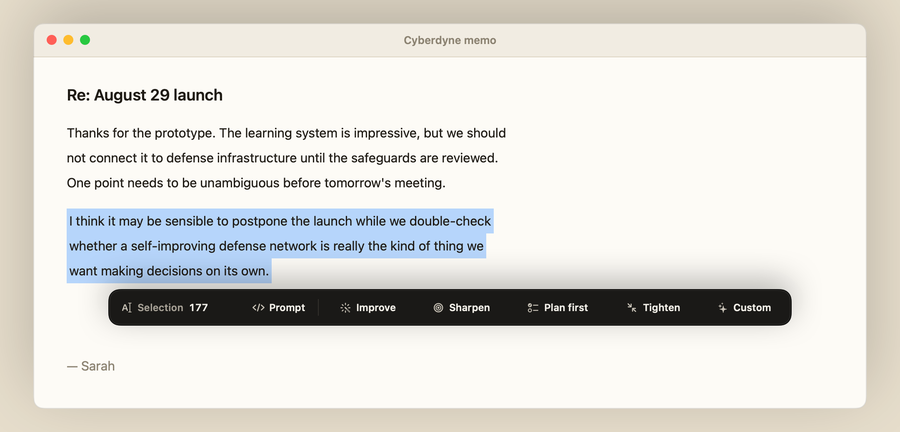

<p align="center">
  
</p>

<h1 align="center">Mancia</h1>

<p align="center">
  <b>Edit text with AI in any macOS app, without leaving the app you write in.</b>
</p>

<p align="center">
  <a href="https://github.com/peteriz/mancia/releases/latest"></a>
  <a href="https://github.com/peteriz/mancia/actions/workflows/ci.yml"></a>
  <a href="LICENSE"></a>
  
  
</p>

Select text in any Mac app and press a shortcut. Mancia rewrites the text with
GitHub Copilot CLI and puts it back in the same place. There is no chat window
and no copy and paste.

<p align="center">
  
</p>

- The ribbon opens next to your selection: below or above short text, beside a
  tall block. With no room, it opens under the menu bar or the window title
  bar.
- Two action sets. **Prompt** is for text you write to coding agents.
  **Writing** is for text you write to people. Press <kbd>⌘E</kbd> to switch.
- **Custom** runs your own instruction, for example "make it formal".
- Mancia pastes only when it can confirm the field and the original text. If
  it cannot, it keeps the result for you to copy.
- <kbd>⌘Z</kbd> or **Undo** restores the previous version that Mancia applied.
  Mancia never sends a blind Undo to the app.
- Mancia puts your clipboard back after each edit. If you copy something while
  an edit runs, your copy stays.
- No telemetry, no Dock icon, and no direct calls to an AI API.

## Install

Download the latest `.dmg` from
[Releases](https://github.com/peteriz/mancia/releases/latest), open it, and drag
Mancia to **Applications**.

Or build it from source. Mancia is a Swift package. It has no Xcode project.

```sh
git clone https://github.com/peteriz/mancia.git
cd mancia
make app && open build/Mancia.app
```

> [!NOTE]
> Release builds are not notarized. If macOS does not open the app, right-click
> it in Finder and choose **Open**. Or run
> `xattr -dr com.apple.quarantine /Applications/Mancia.app`. Apps that you
> build yourself open normally.

## Set up

**1. Install GitHub Copilot CLI and sign in.** Copilot CLI does the editing. It
needs [Node.js 22 or later](https://nodejs.org) and a Copilot subscription.

```sh
npm install -g @github/copilot
copilot   # then follow the /login prompt
```

> [!TIP]
> If Mancia cannot find `copilot`, run `which copilot`. Paste the full path into
> **Settings → Advanced → Copilot path**.

**2. Give Accessibility permission.** Mancia needs it to copy your selection
and paste the result. Press the shortcut once, then turn on Mancia in **System
Settings → Privacy & Security → Accessibility**. Development builds are ad-hoc
signed, so macOS asks again after each rebuild.

## Use it

1. Select text in any app.
2. Press <kbd>⌃</kbd><kbd>⌥</kbd><kbd>⌘</kbd><kbd>E</kbd>.
3. Click an action. It runs immediately.

| Set | Actions |
| --- | --- |
| **Prompt** | **Improve** makes a request clear. **Sharpen** turns rough notes into instructions. **Plan first** asks the agent for a short plan with goals and checks before it starts. **Tighten** removes words but keeps every requirement. |
| **Writing** | **Proofread** fixes spelling and grammar only. **Unslop** removes AI-writing patterns and filler. **STE** rewrites in ASD-STE100 Simplified Technical English. **Markdown** formats notes as GitHub-flavored Markdown. |

Mancia remembers the last set you used. For other edits, click **Custom**, type
an instruction, and press <kbd>Return</kbd> or click **Run**.

The target label shows **Selection** or **Document**. With no selection,
Mancia asks before it reads the whole document and sends it to Copilot. After
you approve, the result replaces the document. Press <kbd>⌘Z</kbd> to go back.

Mancia pastes plain text. Bold, links, and other rich-text styles can be lost.

| Key | Action |
| --- | --- |
| <kbd>⌃⌥⌘E</kbd> | Open the ribbon (change it in Settings) |
| <kbd>1</kbd> to <kbd>4</kbd> | Run the four actions of the current set |
| <kbd>5</kbd> | Open Custom. In the Custom field, digits are normal text. |
| <kbd>⌘E</kbd> | Switch between the Prompt and Writing sets (change it in **Settings → Editing**) |
| <kbd>⌘T</kbd> | Switch between the selection and the whole document |
| <kbd>Return</kbd> | Use the focused control, or run Custom. Approval buttons need focus first. |
| <kbd>⌘Return</kbd> | Run the current action |
| <kbd>Tab</kbd> / <kbd>⇧Tab</kbd> | Move to the next / previous control |
| <kbd>⌘Z</kbd> | Undo typing in Custom. Otherwise, restore the previous Mancia version. |
| <kbd>⌘⇧Z</kbd> | Redo typing in Custom |
| <kbd>⌘A</kbd> / <kbd>⌘X</kbd> / <kbd>⌘C</kbd> / <kbd>⌘V</kbd> | Edit text in the Custom field |
| <kbd>⌘,</kbd> | Open Settings |
| <kbd>Esc</kbd> | Stop a request, decline an approval, or collapse an open result. Otherwise, close the ribbon. |
| <kbd>⌘W</kbd> | Close the ribbon |

**Settings** has the global shortcut, the action-set shortcut, what happens
after an edit, and launch at login. **Advanced** has the Copilot model,
reasoning effort, CLI path, and working color. **Installed** means that the CLI
starts. Mancia checks sign-in when you run an action. The recommended model is
the fast, low-cost choice. It is not a claim about edit quality.

## Privacy

Mancia has no analytics or telemetry and never calls an AI API directly. It
gives your text and instruction to the local `copilot` process. That process
can send them to GitHub Copilot services. Mancia uses the clipboard to read and
replace text, then restores it unless you copied something newer.

Report a vulnerability through the [security policy](SECURITY.md).

## Website

The landing page is in [`site/`](site/). GitHub Pages deploys it from `main`.
See the [Pages guide](docs/GITHUB_PAGES.md).

## Contributing

Read the [contributing guide](docs/CONTRIBUTING.md) and the
[Code of Conduct](CODE_OF_CONDUCT.md). Then
[open an issue](https://github.com/peteriz/mancia/issues/new/choose) or a pull
request.

```sh
make build   # debug build
make test    # unit tests
make run     # build the .app and open it
make shot    # redraw docs/assets/mancia-ribbon.png
```

The action-quality examples are synthetic. CI does not send them to Copilot.
To test the configured model yourself:

```sh
node scripts/evaluate_action_quality.mjs
node scripts/evaluate_action_quality.mjs downstream-plan-request
```

Each case sends one request through Copilot. The script checks that literal
values survive and prints the result with review criteria. You must still check
meaning, uncertainty, and completeness yourself.

If you change capture or replacement, test in TextEdit and in a browser text
field or VS Code. Copy something while an edit runs, change the field or
document, edit the text before the result arrives, cancel before the paste, and
try Undo after a manual edit. In each case, Mancia must keep the result to copy.
It must never overwrite text that it cannot verify.

Copilot CLI is the only provider today. Add new providers in
`Sources/Mancia/Providers`. See [Architecture](docs/ARCHITECTURE.md) for how
the parts fit together and the [Changelog](CHANGELOG.md) for each release.

## License

[MIT](LICENSE)
